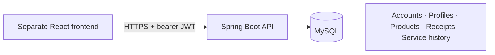

<div align="center">

# ◈ WarrantyHub · Backend

### A private API for warranties, receipts and purchase history.

The **standalone Spring Boot backend** for WarrantyHub. This repository contains only the Java API, database migrations and backend tests.

[Frontend source](https://github.com/c03-renusri/WarrantyHub-frontend) · [API readiness](https://warrantyhub-production.up.railway.app/actuator/health/readiness) · [Deployment guide](DEPLOYMENT.md)


[](https://github.com/c03-renusri/WarrantyHub-backend/actions/workflows/ci.yml)

</div>

## Capabilities

- Registration/login, BCrypt passwords and one-hour signed JWT sessions.
- Owner-checked product CRUD, search and filters, dashboard and upcoming reminders.
- Private PDF/PNG/JPEG receipts stored in MySQL, up to 5 MB.
- Service-history records and progress updates.
- Editable profile details and authenticated profile photos, up to 2 MB / 16 megapixels.
- Password changes revoke older account sessions without deleting purchases.
- Flyway migrations, schema validation, liveness and database-inclusive readiness.

## Architecture



## Run locally

Requires **Java 17**. The Maven wrapper is included.

```sh
export JWT_SECRET="$(openssl rand -base64 32)"
./mvnw spring-boot:run -Dspring-boot.run.profiles=dev
```

The explicit development profile uses persistent H2 data in `data/`. The production profile uses MySQL. The API defaults to port 8080 and allows the frontend at `http://localhost:5173`.

For local MySQL, fill in fresh values in a private copy of `deployment/.env.example`, then:

```sh
docker compose --env-file deployment/.env -f deployment/compose.yaml up --build
```

The Compose backend build now points at this repository's root. Deleting the MySQL volume deletes data.

## Configuration

| Variable | Purpose |
|---|---|
| `JWT_SECRET` | Required base64-encoded random signing key, at least 32 decoded bytes |
| `MYSQLHOST`, `MYSQLPORT`, `MYSQLDATABASE`, `MYSQLUSER`, `MYSQLPASSWORD` | Railway MySQL reference variables |
| `CORS_ORIGINS` | Exact allowed frontend origins |
| `PORT` | HTTP listener; Railway provides it |
| `DB_URL`, `DB_USER`, `DB_PASSWORD` | Optional explicit JDBC overrides; leave unset when using Railway MySQL references |

Keep secrets in the hosting provider or private environment files. `MYSQLDATABASE` must resolve to a non-empty database name. See [DEPLOYMENT.md](DEPLOYMENT.md) for standalone repository settings.

## API overview

Except registration, login and health, requests require `Authorization: Bearer <token>`.

| Route | Methods | Purpose |
|---|---|---|
| `/api/auth/register`, `/api/auth/login` | POST | Register or create a session |
| `/api/auth/me` | GET, PUT | Profile `{name,phone,location,bio}` |
| `/api/auth/me/photo` | GET, PUT, DELETE | Private photo; upload multipart field `file` |
| `/api/auth/password` | PUT | `{currentPassword,newPassword}`; replacement session |
| `/api/products` | GET, POST | Search (`q`, `category`, `status`) or create |
| `/api/products/{id}` | GET, PUT, DELETE | Purchase CRUD |
| `/api/products/{id}/receipt` | GET, POST, DELETE | Private receipt, multipart field `file` |
| `/api/products/{id}/service-requests` | GET, POST | Service history |
| `/api/products/{id}/service-requests/{requestId}` | PUT, DELETE | Change service status or remove record |
| `/api/dashboard`, `/api/reminders` | GET | Summary and upcoming expiries |
| `/actuator/health/readiness` | GET | Process and database readiness |
| `/actuator/health/liveness` | GET | Process liveness |

## Coverage and security

Dates use **Asia/Kolkata** and calendar months with month-end/leap-day clamping. Coverage includes the expiry date. Expiring soon means 0–30 days remaining; expired means expiry before today. Prices use decimal storage in INR.

Receipt/photo bytes stay in MySQL across redeploys. Photos are decoded, square-cropped, resized to at most 512px and re-encoded as JPEG without source metadata. Decoding memory is bounded to one image at a time. JWT validation checks account session version, issuer and expiry. Other users cannot access purchase/receipt/service data; photo endpoints always select the signed-in account.

V1 creates the vault, V2 adds account session versions, V3 adds optional profile fields and the separate photo table. Existing migrations are unchanged. Take database backups and test recovery before storing important documents.

## Verify

```sh
./mvnw verify
```

**17 backend integration tests** cover authentication, ownership, CRUD, receipts, service history, expiry boundaries, profile/photo validation, session revocation and additive migrations. GitHub Actions runs the suite against H2 and a disposable **MySQL 8.4** service. Never run these tests against production.

For a disposable local MySQL instance, set `TEST_DB_URL`, `TEST_DB_USER`, `TEST_DB_PASSWORD` and `TEST_DB_DRIVER=com.mysql.cj.jdbc.Driver` before running tests.

## Operating limits

In-app reminders are implemented; email/push delivery, email verification and password recovery are not. Rate limiting is in-memory; use one replica until a shared limiter is configured. Receipt signatures are checked, but full PDF validation and antivirus scanning are not implemented. Database pagination and backup restore/capacity drills remain separate operating work.

## Separate source links

- [Frontend repository](https://github.com/c03-renusri/WarrantyHub-frontend)
- [Backend repository](https://github.com/c03-renusri/WarrantyHub-backend)

The split preserves the backend's relevant Git history. The former combined repository is retained as a deployment backup. Existing hosted services initially retain their old Git connection; reconnect them using the guide to deploy future pushes from these separate repositories.
